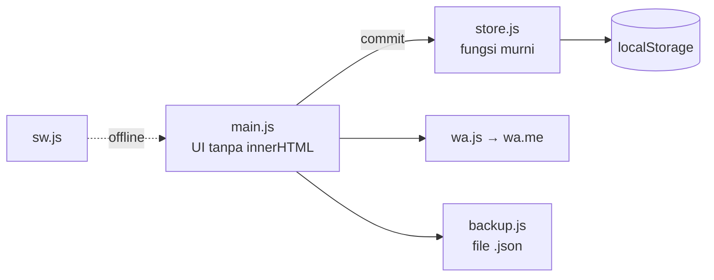

# Kasku

**Buku kasbon digital gratis untuk warung.** Catat utang pelanggan dalam 2 ketukan, tagih sopan lewat WhatsApp, dan data tetap di HP Anda. Tanpa server, tanpa akun.

[](https://github.com/jumpshotcum/test-repo/actions/workflows/pages.yml)
[](LICENSE)

**[Buka aplikasi](https://jumpshotcum.github.io/test-repo/app/)** · [Halaman depan](https://jumpshotcum.github.io/test-repo/) · [Mulai](#mulai) · [Cara kerja](#cara-kerja) · [Dokumen](#dokumen)

<a id="mulai"></a>
## Mulai

Tidak ada langkah build. Jalankan server statis dari root repo:

```bash
python3 -m http.server 8000
```

Buka http://localhost:8000/app/ untuk aplikasi, atau http://localhost:8000/ untuk halaman depan.

Untuk pengguna: buka [aplikasinya](https://jumpshotcum.github.io/test-repo/app/) di HP, lalu pilih **Tambahkan ke layar utama**. Setelah dibuka sekali, Kasku jalan tanpa internet.

<a id="kenapa"></a>
## Kenapa Kasku ada

Idenya diuji dulu sebelum ada kode ([`docs/strategy/verdict.md`](docs/strategy/verdict.md)). Ide awal adalah aplikasi pembukuan berlangganan, dan **hasilnya KILL**. Pemain berdana besar sudah mencobanya: BukuKas/Lummo menutup aplikasinya pada 2023. Simulasi pelanggan pun menunjuk ke rasa sakit yang lain. Jadi Kasku dibentuk ulang:

| | Aplikasi pembukuan biasa | Kasku |
|---|---|---|
| Fokus | Pembukuan lengkap | Kasbon + kas harian |
| Menagih | Manual | Tombol **Tagih via WA** dengan pesan sopan |
| Data | Di server penyedia | Hanya di HP pengguna |
| Akun | Wajib daftar | Tidak ada |
| Biaya | Langganan / iklan | Gratis, MIT |
| Risiko data hilang | Bergantung pada server | Cadangan 1 ketukan + pengingat 7 hari |

<a id="cara-kerja"></a>
## Cara kerja



- **Model data:** satu objek state. Saldo dihitung dari entri, tidak disimpan (`app/js/store.js`).
- **Input uang:** `15rb`, `15.000`, `1,5jt`, dan `Rp 15.000` semuanya dimengerti. Input yang ambigu ditolak (`app/js/format.js`).
- **Privasi:** CSP `'self'` saja di aplikasi. Tidak ada permintaan ke domain lain ([`docs/privacy.md`](docs/privacy.md)).

<a id="bukti"></a>
## Bukti kualitas

Semua angka berikut bisa diulang dari repo ini:

| Pemeriksaan | Hasil |
|---|---|
| Tes unit (`npm run test:unit`) | 19 lulus |
| Tes e2e Playwright, desktop + mobile (`npm run test:e2e`) | 32 lulus |
| Audit render design-qa (320px & 1280px, 3 layar) | 0 blocker, 0 high |
| Kontras WCAG AA (a11y-audit, terang & gelap) | 16/16 pasangan lulus |
| Palet grafik (dataviz `validate_palette.js`) | Semua cek lulus, termasuk buta warna |
| Sinkronisasi locale id ↔ en (i18n `locale_sync.py`) | 0 error |
| Dockerfile (`dockerfile_analyzer.py`) | 100/100 |

<details>
<summary><b>Pengembangan & tes</b></summary>

```bash
npm install
```

```bash
npx playwright install chromium
```

```bash
npm test
```

Kontributor baru: buka tur kode `.tours/new-joiner-kasku.tour` dengan ekstensi VS Code CodeTour.

Teks UI ada di `app/locales/id.js` (sumber) dan `app/locales/en.js`. Setiap kunci harus ada di keduanya.

Setiap kali file yang di-cache berubah, naikkan `VERSION` di `app/sw.js`.
</details>

<details>
<summary><b>Self-hosting dengan Docker</b></summary>

```bash
docker build -t kasku .
```

```bash
docker run --rm -p 8080:8080 kasku
```

nginx berjalan tanpa root dengan header keamanan dan CSP ketat (`deploy/nginx.conf`).
</details>

<a id="dokumen"></a>
## Dokumen

| Dokumen | Isi |
|---|---|
| [Uji ide (roast)](docs/strategy/verdict.md) | Panel 5 sudut pandang, verdict, tes 48 jam |
| [Backlog MVP](docs/product/backlog.md) | Epic, user story, acceptance criteria |
| [Privasi](docs/privacy.md) | Penilaian UU PDP / GDPR |
| [Peluncuran](docs/launch/) | Post LinkedIn, naskah video 30 detik |
| [Jejak skill](docs/skills-used.md) | Skill mana yang dipakai untuk apa |

<a id="batasan"></a>
## Batasan

- Data hanya ada di satu perangkat. Tidak ada sinkronisasi; pindah HP lewat file cadangan.
- File cadangan belum dienkripsi, dan belum ada kunci PIN di dalam aplikasi (direncanakan).
- **Belum ada pengguna nyata.** Langkah berikutnya adalah tes retensi 7 hari dengan 5 warung (lihat verdict).

## Lisensi

[MIT](LICENSE)
